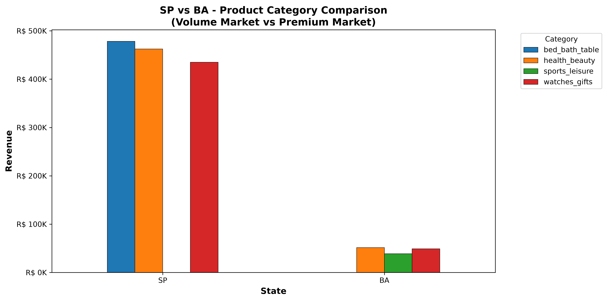

# Olist E-commerce Business Analysis

## Executive Summary
This project provides a comprehensive data-driven analysis of the Olist e-commerce dataset, covering over 100,000 orders and R$ 13.6 million in revenue. The objective was to identify key business drivers through geographical analysis, product performance, and customer satisfaction metrics.

## Key Insights
*   **Geographical Revenue:** São Paulo (SP) is the primary revenue driver, accounting for 38% of total volume.
*   **Customer Segmentation:** While SP leads in volume, states like Bahia (BA) show higher revenue-per-customer, suggesting potential for premium marketing strategies.
*   **Operational Impact:** Late deliveries cause a drastic drop in customer satisfaction, with average review scores falling from 4.29 (on-time) to 2.27 (late).
*   **Product Preferences:** Consistent product preferences across states indicate a stable product-market fit.

## Visualizations

### Revenue by State

### SP vs. BA Comparison (Volume vs. Premium Market)

### Top Product Categories by State

### Impact of Late Delivery on Reviews

## Methodology
1. **Data Preparation:** Merged multiple datasets (Customers, Orders, Items, Products, Reviews) and performed feature engineering (delay calculation, date conversion).
2. **Analysis:** Conducted geographical, temporal, and category-based revenue analysis.
3. **Visualization:** Utilized Matplotlib for insight-driven business reporting.

## Technologies Used
*   **Language:** Python
*   **Libraries:** Pandas, Matplotlib, NumPy
*   **Tools:** Jupyter Notebook (VS Code)
