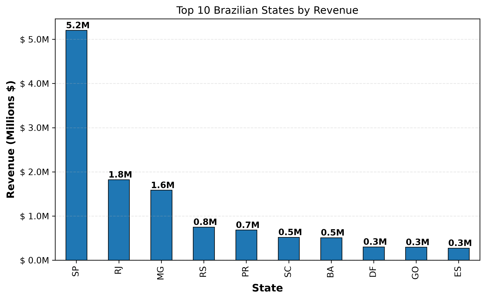
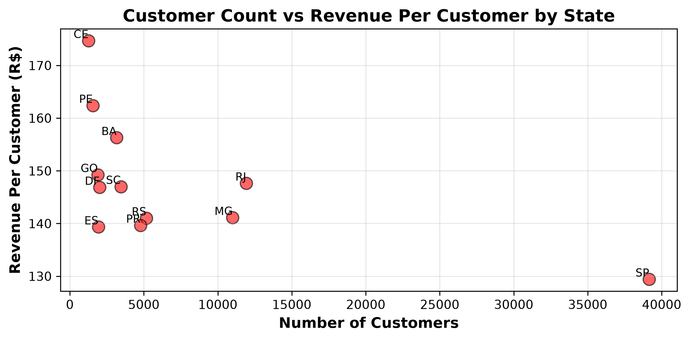
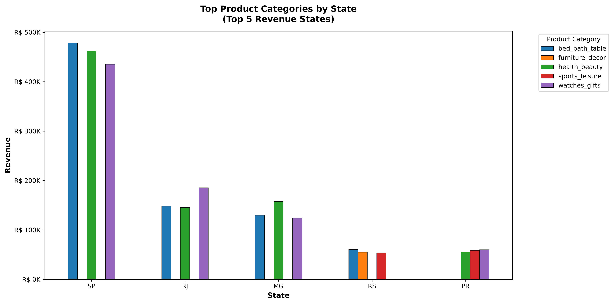
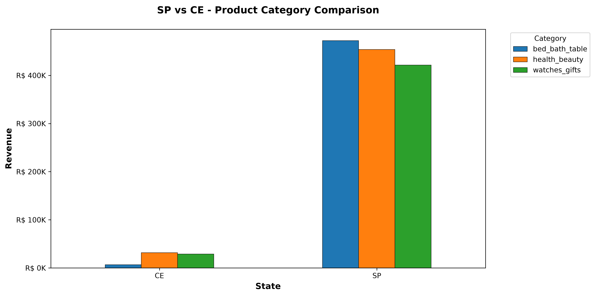
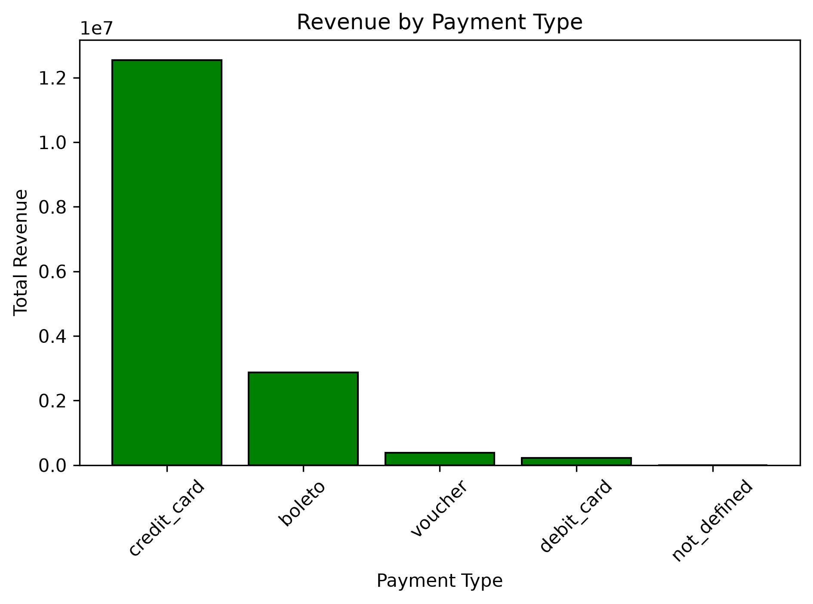
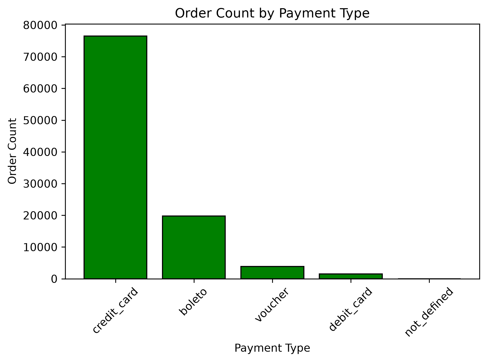
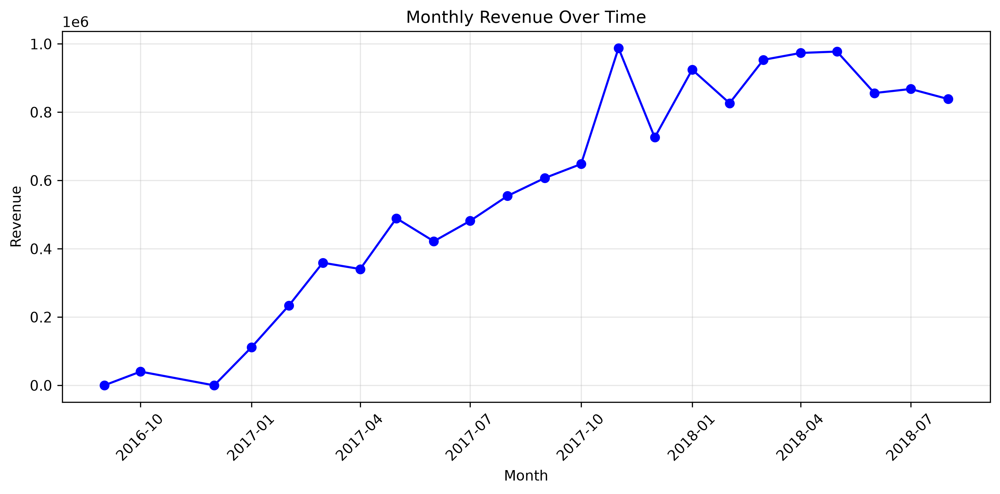
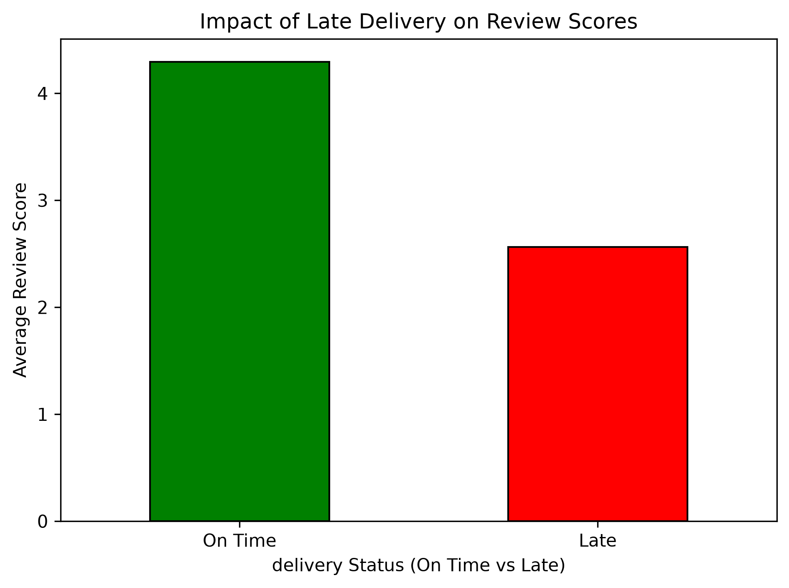
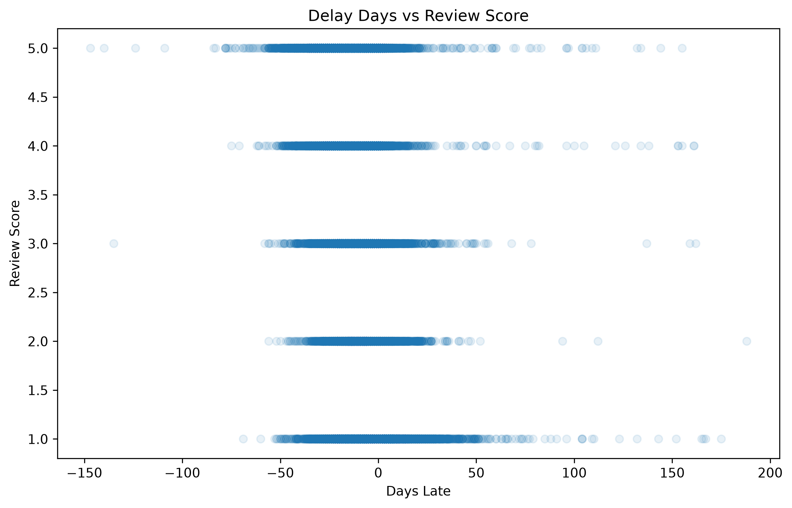

# Olist Brazilian E-Commerce Business Analysis

> A full exploratory data analysis of Brazil's largest e-commerce marketplace — covering **96,478 delivered orders**, **R$ 13.22 million in revenue**, and four core business dimensions: geography, products, payments, and delivery performance.

**Tools:** Python · Pandas · Matplotlib · Jupyter Notebook  
**Dataset:** [Olist Brazilian E-Commerce Public Dataset — Kaggle](https://www.kaggle.com/datasets/olistbr/brazilian-ecommerce)

---

## Table of Contents

- [Project Overview](#project-overview)
- [Dataset](#dataset)
- [1. Geographical Revenue Analysis](#1-geographical-revenue-analysis)
- [2. Product Category Analysis](#2-product-category-analysis)
- [3. Payment Method Analysis](#3-payment-method-analysis)
- [4. Revenue Over Time](#4-revenue-over-time)
- [5. Delivery Performance & Customer Satisfaction](#5-delivery-performance--customer-satisfaction)
- [How to Run](#how-to-run)

---

## Project Overview

This project answers four practical business questions using real transaction data from Olist:

- Which Brazilian states drive the most revenue — and which have the highest-spending customers per order?
- Do product category preferences vary across different markets, or is demand national?
- How do customers pay, and what does that concentration mean for the business?
- How much does a late delivery hurt a customer's review score — and does the damage grow with delay length?

All revenue figures are calculated on **delivered orders only**, so every section of the analysis is consistent and comparable.

---

## Dataset

Seven CSV files are required. Place them all in the same folder as `main.ipynb`.

| File | Description |
|---|---|
| `olist_customers_dataset.csv` | Customer location and unique IDs |
| `olist_orders_dataset.csv` | Order status, timestamps, delivery dates |
| `olist_order_items_dataset.csv` | Items, prices, sellers per order |
| `olist_products_dataset.csv` | Product metadata and category names |
| `product_category_name_translation.csv` | Portuguese → English category mapping |
| `olist_order_payments_dataset.csv` | Payment type and value per order |
| `olist_order_reviews_dataset.csv` | Customer review scores and timestamps |

---

## 1. Geographical Revenue Analysis



São Paulo (SP) generates **R$ 5.07M — 38% of all revenue** on its own. Rio de Janeiro (R$ 1.76M) and Minas Gerais (R$ 1.55M) are distant second and third. The top 3 states together account for over 63% of total revenue.

But total revenue only tells half the story. When revenue is divided by unique customers per state (filtered to states with ≥ 1,000 customers to remove noise from tiny samples), a very different ranking emerges:



| State | Revenue Per Customer (R$) |
|---|---|
| CE (Ceará) | 174.69 |
| PE (Pernambuco) | 162.40 |
| BA (Bahia) | 156.30 |
| GO (Goiás) | ~155 |
| SP (São Paulo) | Lowest among major states |

**SP leads in volume but sits near the bottom on per-customer spend.** The northeast states — CE, PE, BA — have far fewer customers but each one spends significantly more per order. This means volume leadership and value leadership are completely different things, and the northeast represents an underserved high-value segment.

---

## 2. Product Category Analysis



Across all five major states (SP, RJ, MG, RS, PR), the same categories consistently dominate:

- **bed_bath_table**
- **health_beauty**
- **watches_gifts / sports_leisure / computers_accessories**

This consistency across very different markets (SP is a high-volume low-spend state, PR and RS are southern states with different demographics) suggests **product demand in Brazil is national, not regional**. There are no strong niche preferences at the state level.



The SP vs CE comparison reinforces this. Despite CE ranking first in revenue per customer and being a much smaller market overall, its top-performing product categories overlap almost entirely with SP's. The same products sell well everywhere — only the volume differs.

---

## 3. Payment Method Analysis





| Payment Type | Total Revenue | Order Count | Share of Orders |
|---|---|---|---|
| Credit Card | R$ 12,542,084 | 76,505 | ~74% |
| Boleto | R$ 2,869,361 | 19,784 | ~19% |
| Voucher | R$ 379,437 | 3,866 | ~4% |
| Debit Card | R$ 217,990 | 1,528 | ~1% |

> Note: Payment figures cover all order statuses and include freight, so totals exceed the R$ 13.22M delivered-orders revenue figure.

Credit cards account for **74% of all orders and the vast majority of revenue**. This concentration means the business is heavily dependent on card infrastructure — any processing issue would have an outsized impact. Boleto (Brazil's bank slip system) is the primary fallback for customers without or preferring not to use cards.

---

## 4. Revenue Over Time



| Year | Total Revenue | Coverage |
|---|---|---|
| 2016 | R$ 40,471 | Sep – Dec only |
| 2017 | R$ 5,962,902 | Full year |
| 2018 | R$ 7,218,125 | Jan – Aug only |

Because 2016 covers only the last four months and 2018 covers only the first eight, the annual totals cannot be compared directly. The monthly chart is a more honest view — it shows **strong growth through all of 2017 and into early 2018**, followed by a relatively flat trend for the remainder of the available data window.

---

## 5. Delivery Performance & Customer Satisfaction



Late delivery has a severe and measurable effect on how customers rate their experience:

| Delivery Status | Average Review Score |
|---|---|
| On Time | **4.29 / 5.00** |
| Late | **2.57 / 5.00** |

That is a **drop of 1.72 points** — nearly two full stars — just from being late. And the damage is not uniform. It scales with how late:

| Delay Bucket | Avg Review Score | Order Count |
|---|---|---|
| Early / On Time | 4.29 | 88,163 |
| 0 – 3 Days Late | 3.77 | 2,636 |
| 3 – 7 Days Late | 2.32 | 1,773 |
| 7 – 14 Days Late | 1.74 | 1,748 |
| 14 – 30 Days Late | 1.61 | 1,161 |
| 30+ Days Late | 2.03 | 343 |



**91.5% of orders (88,163 out of 96,478) arrive on time or early.** The remaining 8.5% are responsible for a disproportionate amount of customer dissatisfaction. The 7–30 day delay range is particularly damaging — scores collapse to 1.6–1.7. Even a modest improvement in logistics for this segment would meaningfully lift the platform's average rating.

---

## How to Run

1. Clone this repository.
2. Download the Olist dataset from [Kaggle](https://www.kaggle.com/datasets/olistbr/brazilian-ecommerce) and place all seven CSV files in the same folder as `main.ipynb`.
3. Install dependencies:
   ```bash
   pip install pandas matplotlib
   ```
4. Open `main.ipynb` in Jupyter and run **Kernel → Restart & Run All**.

All charts will be saved automatically as `.png` files in the project directory.
